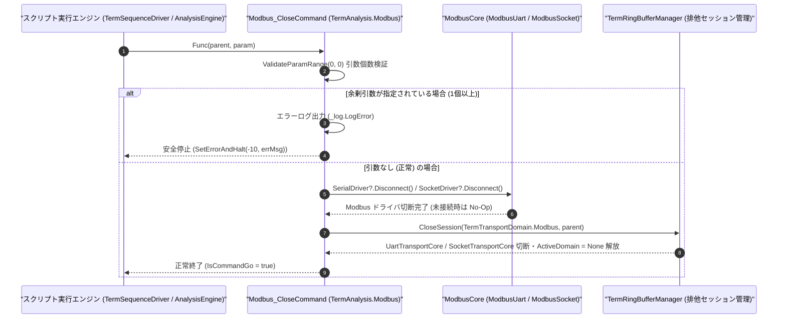

# コマンドリファレンス：Modbus_Close

## 概要

**Modbus_Close** は、現在オープンされている Modbus 通信回線（UART シリアルポートまたは Modbus TCP ソケット）を安全に切断し、通信リソースを解放するコマンドです。

> 💡 **補足** : シーケンス終了時には必ず `Modbus_Close` を呼び出してポートおよびソケットを解放してください。

---

## 💡 書式・パラメータ仕様

### コマンド構文

```csv
,SEQUENCE, [ステップキー], Modbus_Close
```

### パラメータ（引数）一覧

| 引数位置 | パラメータ名 | 必須/任意 | 型・制約 | 説明 |
| :--- | :--- | :---: | :--- | :--- |
| （引数なし） | - | - | - | 現在接続中の Modbus 回線（UART または TCP）をクローズします。 |

---

## 🔄 特殊置換規約・分岐規約の適用

本コマンドの引数における特殊記法および解釈ルールです。
* **動的置換（`$`）** : 本コマンドは引数を取らないため、引数に対する `$PARAMキー$` 動的置換は適用されません。（適用可能な引数: 非適用）
* **ジャンプ先指定（`#`）** : 本コマンドはジャンプ制御を行わないため適用されません。（適用可能な引数: 非適用）
* **共通コマンド指定（`@`）** : 本コマンドは外部マクロを呼び出さないため、共通コマンド呼び出し記法は適用されません。（適用可能な引数: 非適用）
* **カンマのエスケープ** : 通信条件文字列（例: `"9600,E,7,1"`）や複数データのカンマ区切り値を単一引数として渡す場合は、必ず `"..."` と二重引用符で囲んで記述します。
* **エイリアス（別名）** : なし（標準コマンド名 `Modbus_Close` のみ。大文字・小文字は区別されません）

---

## 💡 動作例（正しい構文での記述例）

### スクリプト記述例

※COMMAND ブロック配下の子要素行（PARAM, SEQUENCE）は必ず行頭カンマから開始し、スペースインデントや行末コメント（`;`）は記述しないでください。

```csv
COMMAND, "SAMPLE_MODBUS_CLOSE", ""
,SEQUENCE, 010, Modbus_Mode, "TCP"
,SEQUENCE, 020, Modbus_Open
,SEQUENCE, 030, Modbus_Write, "1", "06", "0x0010", "1234"
,SEQUENCE, 040, Modbus_Close
,SEQUENCE, 050, Exit
```

### 実行時の挙動・変数変化

* **実行前の状態** : Term 通信エンジンが初期化され、必要な通信パラメータおよび変数プール（`PARAM`）が準備されている状態。
* **実行後の状態** : `Modbus_Write` でレジスタ書き込みが完了した後、`Modbus_Close` により Modbus TCP コネクションが切断されます。

---

## 🔄 動作フロー（シーケンス図）



---

## 🚫 エラーハンドリング・安全設計（仕様制限）

1. **余剰引数指定時の境界検証と安全停止** :
   - 本コマンドは引数を取らないため、1 個以上の引数が指定された場合は `ValidateParamRange(0, 0)` によりエラーログを出力し、エラーコード `-10`（`SetErrorAndHalt(-10, errMsg)`）で安全に実行を停止します。
2. **未接続時の安全な無視（No-Op 保証）と切断例外時のフェイルセーフ** :
   - 未接続状態で `Modbus_Close` を実行してもエラーにはならず、安全に次のステップへ進みます。万一ドライバまたはトランスポート切断処理中に予期せぬ例外が発生した場合は `_log.LogCritical` で記録し、`SetErrorAndHalt(-1, ex.Message)` により安全に停止します。なお、クローズ後も直前の `Modbus_Read` で変数または共有バッファに格納されたデータは消去されず参照可能です。

---

## 🧪 ユニットテスト仕様

本コマンドクラス（`Modbus_CloseCommand.cs`）に実装されている `RunUnitTest()` メソッドが検証するユニットテストの仕様です。

### テスト実行前提条件

* **実行トリガー** : `RunUnitTest()` メソッドの呼び出し
* **有効化条件** : システム全体の最小ログレベル（`ErrorLogger.MinimumLevel`）が `LogLevel.Test` であること（それ以外の場合は無効化ガードにより早期リターン）
* **検証結果出力** : `_log.LogTest` によるログ出力。検証失敗時は `_log.LogError`、予期せぬ例外発生時は `_log.LogCritical` で記録し、`finally` ブロックで `UartTransportCore.Shared.IsSimulationMode` を開始前の状態へ復元します。

### テストケース一覧

| No | テストカテゴリ | テスト条件（入力値） | 期待される結果（出力値） | 検証の目的 / 観点 |
| :---: | :--- | :--- | :--- | :--- |
| **1** | 正常系 | `UartTransportCore.Shared.IsSimulationMode = true` 環境下で `OpenExclusiveSession(TermTransportDomain.Modbus, null, useSocket: false)` 確立後、引数なしで `Modbus_Close` を実行 | `!param.HasError` かつ `ActiveDomain == TermTransportDomain.None`、`!ModbusCore.SerialDriver.IsConnected`、`!ModbusCore.SocketDriver.IsConnected` となる | Modbus シリアル／ソケット両ドライバの切断および排他セッション解放の検証 |
| **2** | 異常系 | 余剰引数 1 個（`"EXTRA_INVALID"`）を指定して `Func(null, invalidParam)` を実行（`ValidateParamRange(0, 0)` 違反） | `invalidParam.HasError == true` かつ `!invalidParam.IsCommandGo` で安全に実行拒否・停止する | 引数なし制約の境界検証および誤記引数の混入防止検証 |
