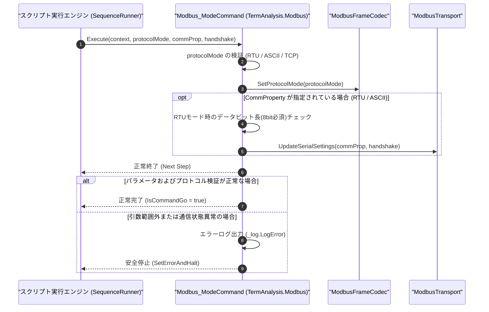

# コマンドリファレンス：Modbus_Mode

## 概要

**Modbus_Mode** は、Modbus 通信の伝送プロトコルモード（`RTU` / `ASCII` / `TCP`）、およびシリアル回線（`RTU` / `ASCII`）使用時の UART 通信条件（ボーレート・パリティ・データビット・ストップビット）とフロー制御を設定するコマンドです。

> 💡 **補足**: `RTU` 選択時はバイナリ＋CRC-16（8bit データ長必須）、`ASCII` 選択時は 16 進テキスト＋LRC（7bit/8bit 可）、`TCP` 選択時は MBAP ヘッダ＋TCP ソケット通信へ内部フレーミングエンジンを切り替えます。

---

## 💡 書式・パラメータ仕様

### コマンド構文

```csv
,SEQUENCE, [ステップキー], Modbus_Mode, "[ProtocolModeOrSettingType: RTU]", "[CommPropertyOrValue]", "[Handshake]", "[LegacyRegAddr]", "[LegacyDataCount]"
```

### パラメータ（引数）一覧

| 引数位置 | 引数名 | 必須/任意 | 説明・制約 |
| :--- | :--- | :---: | :--- |
| 第 1 引数 | `ProtocolModeOrSettingType` | 任意 | Modbus 伝送フレーム方式（`"RTU"` / `"ASCII"` / `"TCP"`、省略時既定値: `"RTU"`）または個別設定種別キーワード。 |
| 第 2 引数 | `CommPropertyOrValue` | 任意 | `RTU` / `ASCII` 時の UART 通信条件（例: `"19200,E,8,1"`）または設定値（省略時既定値: `""`＝現在値維持）。 |
| 第 3 引数 | `Handshake` | 任意 | シリアル通信時のフロー制御方式（`"NONE"` / `"RTSCTS"` / `"XONXOFF"`、省略時既定値: `""`）。 |
| 第 4 引数 | `LegacyRegAddr` | 任意 | 旧構文互換用の既定レジスタ開始アドレス指定（通常は省略、既定値: `""`）。 |
| 第 5 引数 | `LegacyDataCount` | 任意 | 旧構文互換用の既定データ点数指定（通常は省略、既定値: `""`）。 |

---

## 🔄 特殊置換規約・分岐規約の適用

本コマンドの引数における特殊記法および解釈ルールです。
* **動的置換（`$`）**: 引数内で `$PARAMキー$` のように記述すると、実行時に変数プール（PARAM）の値へ動的置換されます。（適用可能な引数: 全引数対応）
* **ジャンプ先指定（`#`）**: 本コマンドはジャンプ制御を行わないため適用されません。（適用可能な引数: 非適用）
* **共通コマンド指定（`@`）**: 本コマンドは外部マクロを呼び出さないため、共通コマンド呼び出し記法は適用されません。（適用可能な引数: 非適用）
* **カンマのエスケープ**: 通信条件文字列（例: `"9600,E,7,1"`）や複数データのカンマ区切り値を単一引数として渡す場合は、必ず `"..."` と二重引用符で囲んで記述します。
* **エイリアス（別名）**: `Analysis_ModBus_Mode`

---

## 💡 動作例（正しい構文での記述例）

### スクリプト記述例

※COMMAND ブロック配下の子要素行（PARAM, SEQUENCE）は必ず行頭カンマから開始し、スペースインデントや行末コメント（`;`）は記述しないでください。

```csv
COMMAND, "SAMPLE_MODBUS_MODE", ""
; 1. Modbus RTUモード（19200bps, 偶数パリティ, 8bit, Stop 1）に設定
,SEQUENCE, 010, Modbus_Mode, "RTU", "19200,E,8,1", "NONE"
,SEQUENCE, 020, Modbus_Open
,SEQUENCE, 030, Modbus_Read, "1", "03", "0000", "1", "$RTU_VAL$"
,SEQUENCE, 040, Modbus_Close
; 2. Modbus ASCIIモード（9600bps, 偶数パリティ, 7bit, Stop 1）に切り替え
,SEQUENCE, 050, Modbus_Mode, "ASCII", "9600,E,7,1", "NONE"
,SEQUENCE, 060, Modbus_Open
,SEQUENCE, 070, Modbus_Read, "1", "03", "0000", "1", "$ASC_VAL$"
,SEQUENCE, 080, Modbus_Close
; 3. Modbus TCPモードに切り替え（IPとポートはUI設定を使用）
,SEQUENCE, 090, Modbus_Mode, "TCP"
,SEQUENCE, 100, Modbus_Open
,SEQUENCE, 110, Modbus_Read, "1", "03", "0000", "1", "$TCP_VAL$"
,SEQUENCE, 120, Modbus_Close
,SEQUENCE, 130, Exit
```

### 実行時の挙動・変数変化

* **実行前の状態**: Term 通信エンジンが初期化され、必要な通信パラメータおよび変数プール（`PARAM`）が準備されている状態。
* **実行後の状態**: 1 回目の `Modbus_Mode` では RTU バイナリフレーミング（CRC-16）と 8 データビット UART 設定が適用されます。 2 回目の `Modbus_Mode` では ASCII フレーミング（`:` 開始、LRC、`CR+LF` 終端）と 7 データビット UART 設定に切り替わります。 3 回目の `Modbus_Mode` では TCP ソケット（MBAP ヘッダ付与、CRC なし）に切り替わります。

---

## 🔄 動作フロー（シーケンス図）



---

## 🚫 エラーハンドリング・安全設計（仕様制限）

1. **Modbus RTU モードにおけるデータビット 7bit 指定の防止**:
   - Modbus 標準仕様上、`RTU`（バイナリ）モードは 8bit データ長が必須です。`RTU` モードでデータビット `7`（例: `"9600,E,7,1"`）が指定された場合は、`ArgumentException` を送出してフレーム破損を未然に防止します。
2. **未定義プロトコルモードの拒否**:
   - 第 1 引数に `RTU` / `ASCII` / `TCP` 以外の文字列が指定された場合は即座にエラーを送出します。

---

## 🧪 ユニットテスト仕様

本コマンドクラス（`Modbus_ModeCommand.cs`）に実装されている `RunUnitTest()` メソッドが検証するユニットテストの仕様です。

### テスト実行前提条件

* **実行トリガー**: `RunUnitTest()` メソッドの呼び出し
* **有効化条件**: システム全体の最小ログレベル（`ErrorLogger.MinimumLevel`）が `LogLevel.Test` であること（それ以外の場合は無効化ガードにより早期リターン）
* **検証結果出力**: `_log.LogTest` によるログ出力。検証失敗時は `_log.LogError`、予期せぬ例外発生時は `_log.LogCritical` で記録し、`finally` ブロックで `CurrentMode = ModbusProtocolMode.RTU`、`"9600,N,8,1"`、`"None"`、および `SerialDriver`（`BaudRate = 9600`, `DataBits = 8`）へ初期状態を復元します。

### テストケース一覧

| No | テストカテゴリ | テスト条件（入力値） | 期待される結果（出力値） | 検証の目的 / 観点 |
| :---: | :--- | :--- | :--- | :--- |
| **1** | 正常系 | 引数 `"RTU"`, `"19200,E,8,1"`, `"RtsCts"` の 3 引数を指定して実行 | `!param.HasError` かつ `CurrentMode == ModbusProtocolMode.RTU`、`Master.ProtocolMode == ModbusProtocolMode.Rtu`、UART および `SerialDriver` の `BaudRate == 19200`・`DataBits == 8` となる | Modbus RTU 伝送モード・シリアル通信条件・RTS/CTS フロー制御の一括反映検証 |
| **2** | 異常系 | 引数なしまたは 6 個以上の指定（`ValidateParamRange(1, 5)` 違反）、および不正設定文字列による例外発生 | 引数範囲外エラー出力による早期リターン、または `_log.LogCritical` 記録と `SetErrorAndHalt(-1, ex.Message)` による安全停止 | 引数個数境界ガードおよび通信条件更新例外時のクラッシュ防御検証 |
