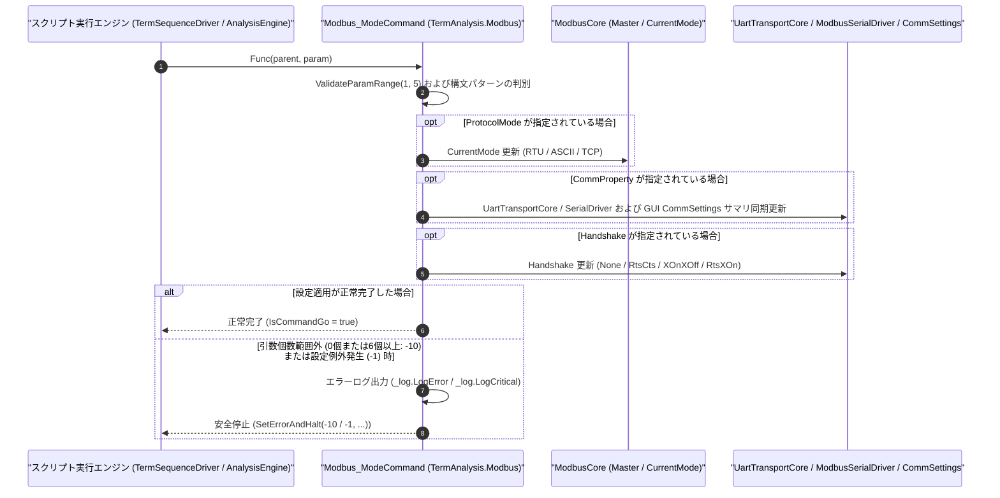

# コマンドリファレンス：Modbus_Mode

## 概要

**Modbus_Mode** は、Modbus 通信の伝送プロトコルモード（`RTU` / `ASCII` / `TCP`）、およびシリアル回線（`RTU` / `ASCII`）使用時の UART 通信条件（ボーレート・パリティ・データビット・ストップビット）とフロー制御を設定するコマンドです。

> 💡 **補足** : `RTU` 選択時はバイナリ＋CRC-16、`ASCII` 選択時は 16 進テキスト＋LRC、`TCP` 選択時は MBAP ヘッダ＋TCP ソケット通信へ内部フレーミングエンジン（`ModbusCore`）を切り替えます。

---

## 💡 書式・パラメータ仕様

### コマンド構文

```csv
; 1. 標準構文（1〜3 引数）
,SEQUENCE, [ステップキー], Modbus_Mode, "<ProtocolModeOrCommProperty>", "[CommPropertyOrHandshake]", "[Handshake]"

; 2. 個別キー・値指定構文（2 引数）
,SEQUENCE, [ステップキー], Modbus_Mode, "<SettingType>", "<Value>"

; 3. 旧 Analysis_ModBus_Mode 互換構文（5 引数）
,SEQUENCE, [ステップキー], Modbus_Mode, "<TransMode>", "<SlaveAddr>", "<FuncCode>", "<RegAddr>", "<DataCount>"
```

※ 本コマンドは最低 1 引数の指定が必須です（1〜5 引数）。

### パラメータ（引数）一覧

| 引数位置 | 引数名 | 必須/任意 | 説明・制約 |
| :--- | :--- | :---: | :--- |
| 第 1 引数 | `ProtocolModeOrSettingType` | **必須** | ・標準構文：Modbus 伝送フレーム方式（`"RTU"` / `"ASCII"` / `"TCP"`。`"SOCKET"` / `"2"` は `TCP`、`"1"` は `ASCII`、その他未知の文字列は `RTU`）または UART 通信条件文字列（例: `"19200,E,8,1"`）。<br>・2 引数キー指定時：`MODE` / `PROTOCOL`, `SLAVEID` / `SLAVE`, `PROPERTY` / `COMMPROPERTY`, `HANDSHAKE`, `HOST` / `IP`, `PORT` のいずれか。 |
| 第 2 引数 | `CommPropertyOrValue` | 任意 | ・標準構文：`RTU` / `ASCII` 時の UART 通信条件（例: `"19200,E,8,1"`）またはフロー制御（省略時は現在値維持）。<br>・2 引数キー指定時：第 1 引数のキーに対応する設定値。<br>・5 引数旧互換時：既定スレーブ局番（`0`〜`255`）。 |
| 第 3 引数 | `Handshake` | 任意 | ・標準構文：シリアル通信時のフロー制御方式（`"NONE"` / `"RTSCTS"` / `"XONXOFF"` / `"RTSXON"`［`"BOTH"`］）。<br>・5 引数旧互換時：既定ファンクションコード。 |
| 第 4 引数 | `LegacyRegAddr` | 任意 | 5 引数旧構文互換用の既定レジスタ開始アドレス（16 進表記時は `"0x0010"` のように `0x` 接頭辞を付与）。 |
| 第 5 引数 | `LegacyDataCount` | 任意 | 5 引数旧構文互換用の既定データ点数（`1` 以上の整数）。 |

---

## 🔄 特殊置換規約・分岐規約の適用

本コマンドの引数における特殊記法および解釈ルールです。
* **動的置換（`$`）** : 引数内で `$PARAMキー$` のように記述すると、実行時に変数プール（PARAM）の値へ動的置換されます。（適用可能な引数: 全引数対応）
* **ジャンプ先指定（`#`）** : 本コマンドはジャンプ制御を行わないため適用されません。（適用可能な引数: 非適用）
* **共通コマンド指定（`@`）** : 本コマンドは外部マクロを呼び出さないため、共通コマンド呼び出し記法は適用されません。（適用可能な引数: 非適用）
* **カンマのエスケープ** : 通信条件文字列（例: `"9600,E,7,1"`）や複数データのカンマ区切り値を単一引数として渡す場合は、必ず `"..."` と二重引用符で囲んで記述します。
* **エイリアス（別名）** : `Analysis_ModBus_Mode`

---

## 💡 動作例（正しい構文での記述例）

### スクリプト記述例

※COMMAND ブロック配下の子要素行（PARAM, SEQUENCE）は必ず行頭カンマから開始し、スペースインデントや行末コメント（`;`）は記述しないでください。

```csv
COMMAND, "SAMPLE_MODBUS_MODE", ""
,PARAM, "RTU_VAL", Work, "RTU読出値", ""
,PARAM, "ASC_VAL", Work, "ASCII読出値", ""
,PARAM, "TCP_VAL", Work, "TCP読出値", ""
; 1. Modbus RTUモード（19200bps, 偶数パリティ, 8bit, Stop 1）に設定
,SEQUENCE, 010, Modbus_Mode, "RTU", "19200,E,8,1", "NONE"
,SEQUENCE, 020, Modbus_Open
,SEQUENCE, 030, Modbus_Read, "1", "03", "0x0000", "1", "RTU_VAL"
,SEQUENCE, 040, Modbus_Close
; 2. Modbus ASCIIモード（9600bps, 偶数パリティ, 7bit, Stop 1）に切り替え
,SEQUENCE, 050, Modbus_Mode, "ASCII", "9600,E,7,1", "NONE"
,SEQUENCE, 060, Modbus_Open
,SEQUENCE, 070, Modbus_Read, "1", "03", "0x0000", "1", "ASC_VAL"
,SEQUENCE, 080, Modbus_Close
; 3. Modbus TCPモードに切り替え（接続先IPとポートを明示してオープン）
,SEQUENCE, 090, Modbus_Mode, "TCP"
,SEQUENCE, 100, Modbus_Open, "TCP", "192.168.0.10", 502
,SEQUENCE, 110, Modbus_Read, "1", "03", "0x0000", "1", "TCP_VAL"
,SEQUENCE, 120, Modbus_Close
,SEQUENCE, 130, Exit
```

### 実行時の挙動・変数変化

* **実行前の状態** : Term 通信エンジンが初期化され、必要な通信パラメータおよび変数プール（`PARAM`）が準備されている状態。
* **実行後の状態** : 1 回目の `Modbus_Mode` では RTU バイナリフレーミング（CRC-16）と 8 データビット UART 設定が適用されます（GUI 接続時は通常シリアル設定サマリ `CommSettings.ComSettingsSummary` にも同期反映されます）。 2 回目の `Modbus_Mode` では ASCII フレーミング（`:` 開始、LRC、`CR+LF` 終端）と 7 データビット UART 設定に切り替わります。 3 回目の `Modbus_Mode` では TCP ソケット（MBAP ヘッダ付与、CRC なし）に切り替わり、続く `Modbus_Open` で指定先 `192.168.0.10:502`（引数省略時は `SocketTransportCore.Shared` の現在値）へ接続します。

---

## 🔄 動作フロー（シーケンス図）



---

## 🚫 エラーハンドリング・安全設計（仕様制限）

1. **引数個数の境界検証（1〜5 引数必須）** :
   - 引数を 1 つも指定せずに呼び出した場合や 6 個以上指定した場合は、`ValidateParamRange(1, 5)` によりエラーログを出力し、エラーコード `-10`（`SetErrorAndHalt(-10, errMsg)`）で安全に実行を停止します。
2. **モード・通信条件の安全なフォールバックと GUI シリアル設定連動** :
   - プロトコルモードに `"TCP"`（`"SOCKET"` / `"2"`）および `"ASCII"`（`"1"`）以外の文字列を渡した場合は安全に既定の `"RTU"` モードへフォールバックします。また `CommProperty`（UART 条件）を指定した場合、`UartTransportCore.Shared` と `ModbusCore.SerialDriver` に加えて、GUI 接続時はメイン画面の通常シリアル設定サマリ（`CommSettings.ComSettingsSummary`）へも反映されます。`RTU`（バイナリ）モード使用時は相手機器の仕様に合わせて必ずデータビット長 `8`（例: `"19200,E,8,1"`）を指定してください。

---

## 🧪 ユニットテスト仕様

本コマンドクラス（`Modbus_ModeCommand.cs`）に実装されている `RunUnitTest()` メソッドが検証するユニットテストの仕様です。

### テスト実行前提条件

* **実行トリガー** : `RunUnitTest()` メソッドの呼び出し
* **有効化条件** : システム全体の最小ログレベル（`ErrorLogger.MinimumLevel`）が `LogLevel.Test` であること（それ以外の場合は無効化ガードにより早期リターン）
* **検証結果出力** : `_log.LogTest` によるログ出力。検証失敗時は `_log.LogError`、予期せぬ例外発生時は `_log.LogCritical` で記録し、`finally` ブロックで `CurrentMode = ModbusProtocolMode.RTU`、`"9600,N,8,1"`、`"None"`、および `SerialDriver`（`BaudRate = 9600`, `DataBits = 8`）へ初期状態を復元します。

### テストケース一覧

| No | テストカテゴリ | テスト条件（入力値） | 期待される結果（出力値） | 検証の目的 / 観点 |
| :---: | :--- | :--- | :--- | :--- |
| **1** | 正常系 | 引数 `"RTU"`, `"19200,E,8,1"`, `"RtsCts"` の 3 引数を指定して実行 | `!param.HasError` かつ `CurrentMode == ModbusProtocolMode.RTU`、`Master.ProtocolMode == ModbusProtocolMode.Rtu`、UART および `SerialDriver` の `BaudRate == 19200`・`DataBits == 8` となる | Modbus RTU 伝送モード・シリアル通信条件・RTS/CTS フロー制御の一括反映検証 |
| **2** | 異常系 | 必須引数を省略（引数 0 個）して `Func(null, invalidParam)` を実行（`ValidateParamRange(1, 5)` 違反） | `invalidParam.HasError == true` かつ `!invalidParam.IsCommandGo` で安全に実行拒否・停止する | 必須第 1 引数欠落時の境界ガード検証 |
