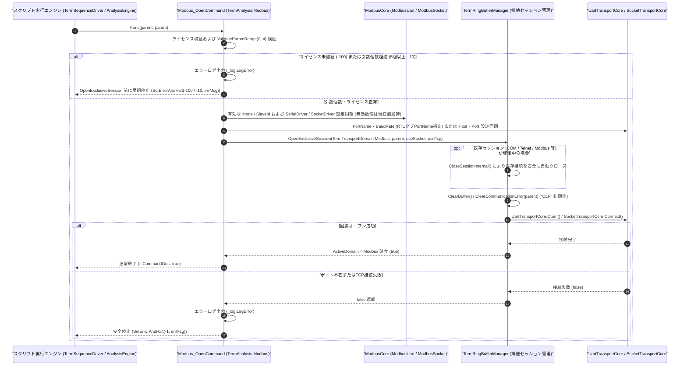

# コマンドリファレンス：Modbus_Open

## 概要

**Modbus_Open** は、Term アプリケーションの UI 設定および `Modbus_Mode` で指定された伝送モード（`RTU` / `ASCII` の場合は UART シリアルポート、`TCP` の場合は TCP ソケット回線）をオープンし、Modbus マスター通信セッションを開始するコマンドです。
実行時に Term 通信制御の排他選択モードを **Modbus モード** （`TermAnalysis.Modbus.dll`）へ確定させます。

> 💡 **補足** : 引数を省略した場合、RTU / ASCII モードでは UI「Modbus RTU」タブの `PortName` および `UartTransportCore.Shared` / `ModbusCore.DefaultSlaveAddress` の現在設定値を使用し、TCP モードでは `SocketTransportCore.Shared` の現在設定値（初期値 `"127.0.0.1:502"`）を使用して下位トランスポートをオープンします。引数を指定した場合は個別条件でオーバーライド可能です。RTU / ASCII モードでは物理 COM ポートのほか、仮想シリアル中継ツール **[c2c](https://github.com/Monaca-App/c2c)** が公開中の仮想 COM ポート（例: `COM10` ⇔ `COM11`）も透過的にオープン可能です。

---

## 💡 書式・パラメータ仕様

### コマンド構文

```csv
,SEQUENCE, [ステップキー], Modbus_Open, "[Mode]", "[PortOrIp]", "[BaudOrPort: 0]", "[SlaveId: 1]"
```

※ 全引数を省略した場合は、`ModbusCore.CurrentMode` に応じて RTU / ASCII 時は UI「Modbus RTU」タブの `PortName` と `UartTransportCore.Shared` の現在値、TCP 時は `SocketTransportCore.Shared` の現在設定値（初期値 `"127.0.0.1:502"`）を使用してオープンします。

### パラメータ（引数）一覧

| 引数位置 | 引数名 | 必須/任意 | 説明・制約 |
| :--- | :--- | :---: | :--- |
| 第 1 引数 | `Mode` | 任意 | 伝送モード指定（`"RTU"` / `"ASCII"` / `"TCP"`、省略または空文字時は `ModbusCore.CurrentMode` の現在値を維持）。 |
| 第 2 引数 | `PortOrIp` | 任意 | シリアル COM ポート名（例: `"COM3"`）または接続先 IP アドレス（例: `"192.168.1.50"`）。省略時、RTU / ASCII モードでは UI「Modbus RTU」タブの `PortName`（未取得時は `UartTransportCore.Shared.PortName` の現在値）、TCP モードでは `SocketTransportCore.Shared.Host` の現在値（初期値 `"127.0.0.1"`）を使用します。 |
| 第 3 引数 | `BaudOrPort` | 任意 | シリアル時のボーレート［bps］（`300` 以上）または TCP 時のポート番号（`1`〜`65535`）。省略時または数値変換不能・範囲外の値が渡された場合は無視して現在値を維持します（TCP モードで現在ポートが Telnet 初期値 `23` のままである場合は自動的に `502` へ切り替わります）。 |
| 第 4 引数 | `SlaveId` | 任意 | 既定ターゲットのスレーブ局番／ユニット ID（`0`〜`255`）。省略時または `0`〜`255` 外／非数値文字列が渡された場合は無視して `ModbusCore.DefaultSlaveAddress` の現在値（初期値 `1`）を維持します。 |

---

## 🔄 特殊置換規約・分岐規約の適用

本コマンドの引数における特殊記法および解釈ルールです。
* **動的置換（`$`）** : 引数内で `$PARAMキー$` のように記述すると、実行時に変数プール（PARAM）の値へ動的置換されます。（適用可能な引数: 全引数対応）
* **ジャンプ先指定（`#`）** : 本コマンドはジャンプ制御を行わないため適用されません。（適用可能な引数: 非適用）
* **共通コマンド指定（`@`）** : 本コマンドは外部マクロを呼び出さないため、共通コマンド呼び出し記法は適用されません。（適用可能な引数: 非適用）
* **カンマのエスケープ** : 通信条件文字列（例: `"9600,E,7,1"`）や複数データのカンマ区切り値を単一引数として渡す場合は、必ず `"..."` と二重引用符で囲んで記述します。
* **エイリアス（別名）** : なし（標準コマンド名 `Modbus_Open` のみ。大文字・小文字は区別されません）

---

## 💡 動作例（正しい構文での記述例）

### スクリプト記述例

※COMMAND ブロック配下の子要素行（PARAM, SEQUENCE）は必ず行頭カンマから開始し、スペースインデントや行末コメント（`;`）は記述しないでください。

```csv
COMMAND, "SAMPLE_MODBUS_OPEN", ""
,PARAM, "REG_DATA", Work, "保持レジスタ読出値", ""
; 1. Modbus RTUモード（38400bps, Even, 8bit, Stop 1）を設定して回線オープン
,SEQUENCE, 010, Modbus_Mode, "RTU", "38400,E,8,1", "NONE"
,SEQUENCE, 020, Modbus_Open
; 2. スレーブ局番1の保持レジスタ(FC03) 開始アドレス0x0000から2ワード読出
,SEQUENCE, 030, Modbus_Read, "1", "03", "0x0000", "2", "REG_DATA"
,SEQUENCE, 040, Modbus_Close
,SEQUENCE, 050, Exit
```

### 実行時の挙動・変数変化

* **実行前の状態** : Term 通信エンジンが初期化され、必要な通信パラメータおよび変数プール（`PARAM`）が準備されている状態。
* **実行後の状態** : `Modbus_Mode` により `RTU` フレーム形式および UART 通信条件（`38400,E,8,1`）が設定されます。 `Modbus_Open` により既存の通信セッションがある場合は自動クローズされた上でシリアルポートが開かれ、Modbus RTU フレーム送受信エンジンが確立されます。続く `Modbus_Read` で読み出された 2 ワード値がカンマ区切りで変数 `REG_DATA` に格納されます。

---

## 🔄 動作フロー（シーケンス図）



---

## 🚫 エラーハンドリング・安全設計（仕様制限）

1. **既存セッションからの安全な自動切替（`OpenExclusiveSession`）と不正数値引数の現在値維持** :
   - すでに Modbus 回線または他ドメイン（`Com_Open` / `Telnet_Open` 等）のセッションが稼働している場合は、既存接続を安全に自動クローズしてから新しい Modbus セッションへ排他切り替えします。また `BaudOrPort` や `SlaveId` に数値変換不能または許容範囲外の文字列が渡された場合は例外停止せず無視し、現在設定されている値をそのまま維持します。
2. **引数個数超過（`-10`）・接続失敗（`-1`）・ライセンス未認証（`-100`）時の安全停止** :
   - `Modbus` エクステンションライセンス未認証時はエラーコード **`-100`** 、引数が 5 個以上指定された場合（`ValidateParamRange(0, 4)` 違反）はエラーコード **`-10`** を設定して早期安全停止します。対象 COM ポートの不在・使用中、または Modbus TCP 接続タイムアウト時にはエラーログを記録し、`SetErrorAndHalt(-1, errMsg)` によりシーケンスを安全に停止します。

---

## 🧪 ユニットテスト仕様

本コマンドクラス（`Modbus_OpenCommand.cs`）に実装されている `RunUnitTest()` メソッドが検証するユニットテストの仕様です。

### テスト実行前提条件

* **実行トリガー** : `RunUnitTest()` メソッドの呼び出し
* **有効化条件** : システム全体の最小ログレベル（`ErrorLogger.MinimumLevel`）が `LogLevel.Test` であること（それ以外の場合は無効化ガードにより早期リターン）
* **検証結果出力** : `_log.LogTest` によるログ出力。検証失敗時は `_log.LogError`、予期せぬ例外発生時は `_log.LogCritical` で記録し、`finally` ブロックで `CloseSession(TermTransportDomain.Modbus, null)`、`ModbusCore.CurrentMode = ModbusProtocolMode.RTU`、`DefaultSlaveAddress = 1`、および UART／Socket の `IsSimulationMode` 復元を実行します。

### テストケース一覧

| No | テストカテゴリ | テスト条件（入力値） | 期待される結果（出力値） | 検証の目的 / 観点 |
| :---: | :--- | :--- | :--- | :--- |
| **1** | 正常系 | UART／Socket 両方の `IsSimulationMode = true` 環境下で引数 `"TCP"`, `"192.168.0.100"`, `"502"`, `"2"` を指定して実行 | `!param.HasError` かつ `ActiveDomain == TermTransportDomain.Modbus`、`CurrentMode == ModbusProtocolMode.TCP`、`Master.ProtocolMode == ModbusProtocolMode.Tcp`、`SocketTransportCore` と `ModbusCore.SocketDriver` の `Host == "192.168.0.100"`・`Port == 502`、`DefaultSlaveAddress == 2` となる | Modbus TCP 伝送モード・ホスト IP・ポート番号・既定スレーブ局番の同期反映と排他接続確立の検証 |
| **2** | 異常系 | 余剰引数 5 個（`"TCP"`, `"192.168.0.100"`, `"502"`, `"2"`, `"EXTRA_INVALID"`）を指定して `Func(null, invalidParam)` を実行（`ValidateParamRange(0, 4)` 違反） | `invalidParam.HasError == true` かつ `!invalidParam.IsCommandGo` で安全に実行拒否・停止する | 引数上限（最大 4 個）の境界ガード検証 |
