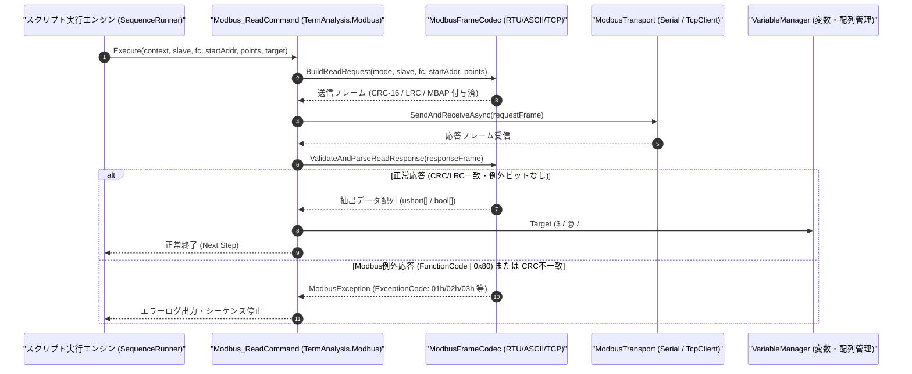

# コマンドリファレンス：Modbus_Read

## 概要

**Modbus_Read** は、指定されたスレーブ局番（Slave ID）の Modbus 機器に対して読み出しファンクションコード（FC01: コイル読出、FC02: 入力ステータス読出、FC03: 保持レジスタ読出、FC04: 入力レジスタ読出）の要求フレームを自動生成・送信し、応答フレームのエラーチェック（CRC-16 / LRC / MBAP ヘッダ検証）を行った上で、読み出したデータ値を指定ターゲット変数（または配列）へ格納するコマンドです。

> 💡 **補足**: `Modbus_Mode` の設定（`RTU` / `ASCII` / `TCP`）に応じて、CRC-16 計算、`:` 開始＋LRC＋CRLF 変換、または 7 バイト MBAP ヘッダ付与をすべて内部で自動処理します。

---

## 💡 書式・パラメータ仕様

### コマンド構文

```csv
,SEQUENCE, [ステップキー], Modbus_Read, "<SlaveAddr>", "<FuncCode>", "<StartAddr>", "<Points>", "<Target>"
```

### パラメータ（引数）一覧

| 引数位置 | パラメータ名 | 必須/任意 | 型・制約 | 説明 |
| :---: | :--- | :---: | :--- | :--- |
| 第1引数 | `SlaveAddr` | **必須** | 整数または16進表記（`1`〜`247`、TCP時はUnit ID） | 通信対象のスレーブアドレス（局番）を指定します。 |
| 第2引数 | `FuncCode` | **必須** | `"01"` / `"02"` / `"03"` / `"04"`（または整数 `1`〜`4`） | 読み出し用 Modbus ファンクションコードを指定します（`03`: 保持レジスタ、`04`: 入力レジスタ等）。 |
| 第3引数 | `StartAddr` | **必須** | 整数または4桁16進（例: `"0000"`, `"100"`） | 読み出し開始レジスタアドレス（0オリジン相対アドレス）を指定します。 |
| 第4引数 | `Points` | **必須** | 整数（`1`〜`125` ワード / ビット時は `1`〜`2000`） | 読み出す点数（ワード数またはビット数）を指定します。 |
| 第5引数 | `Target` | **必須** | 変数名（`$` / `@`）または配列名（`#`） | 読み出したデータ（複数点の場合はカンマ区切り文字列、または配列要素）の格納先を指定します。 |

---

## 🔄 特殊置換規約・分岐規約の適用

本コマンドの引数における特殊記法および解釈ルールです。
* **動的置換（`$`）**: 引数内で `$PARAMキー$` のように記述すると、実行時に変数プール（PARAM）の値へ動的置換されます。（適用可能な引数: 全引数対応）
* **ジャンプ先指定（`#`）**: 本コマンドはジャンプ制御を行わないため適用されません。（適用可能な引数: 非適用）
* **共通コマンド指定（`@`）**: 本コマンドは外部マクロを呼び出さないため、共通コマンド呼び出し記法は適用されません。（適用可能な引数: 非適用）
* **カンマのエスケープ**: 通信条件文字列（例: `"9600,E,7,1"`）や複数データのカンマ区切り値を単一引数として渡す場合は、必ず `"..."` と二重引用符で囲んで記述します。
* **エイリアス（別名）**: `Analysis_ModBus_Read`

---

## 💡 動作例（正しい構文での記述例）

### スクリプト記述例

※COMMAND ブロック配下の子要素行（PARAM, SEQUENCE）は必ず行頭カンマから開始し、スペースインデントや行末コメント（`;`）は記述しないでください。

```csv
COMMAND, "SAMPLE_MODBUS_READ", ""
,PARAM, "SLAVE_ID", Text, "SLAVE_ID", "1"
,PARAM, "TEMP_PV", Text, "TEMP_PV", "0"
,SEQUENCE, 010, Modbus_Mode, "RTU", "19200,E,8,1", "NONE"
,SEQUENCE, 020, Modbus_Open
; 1. スレーブ1の保持レジスタ(FC03) アドレス0000hから1ワード読み出して $TEMP_PV へ格納
,SEQUENCE, 030, Modbus_Read, "$SLAVE_ID$", "03", "0000", "1", "$TEMP_PV$"
; 2. スレーブ1の入力レジスタ(FC04) アドレス0010hから4ワード読み出して配列 #SENSOR_VAL へ格納
,SEQUENCE, 040, Array_Init, "#SENSOR_VAL", "4"
,SEQUENCE, 050, Modbus_Read, "$SLAVE_ID$", "04", "0010", "4", "#SENSOR_VAL"
,SEQUENCE, 060, Modbus_Close
,SEQUENCE, 070, Exit
```

### 実行時の挙動・変数変化

* **実行前の状態**: Term 通信エンジンが初期化され、必要な通信パラメータおよび変数プール（`PARAM`）が準備されている状態。
* **実行後の状態**: 1 回目の `Modbus_Read` では、RTU フレーム `[01][03][00][00][00][01][84][0A]` が送信され、応答フレームの CRC-16 検証後にデータ値が `$TEMP_PV` に格納されます。 2 回目の `Modbus_Read` では、4 ワード分の応答データが `#SENSOR_VAL[0]` 〜 `#SENSOR_VAL[3]` にそれぞれ格納されます。

---

## 🔄 動作フロー（シーケンス図）



---

## 🚫 エラーハンドリング・安全設計（仕様制限）

1. **CRC-16 / LRC / MBAP トランザクション ID の厳格検証**:
   - 受信フレームのチェックサム不一致やデータ長不整合を検出した場合は、破損データを変数へ書き込まずに通信エラー例外を送出します。
2. **Modbus 例外応答（Exception Response）の識別**:
   - スレーブ機器からファンクションコード最上位ビットが `1`（例: `0x83`）の例外応答が返された場合、例外コード（`01`: 不正機能、`02`: 不正データアドレス、`03`: 不正データ値等）を解読してログ出力します。

---

## 🧪 ユニットテスト仕様

本コマンドクラス（`Modbus_ReadCommand.cs`）に実装されている `RunUnitTest()` メソッドが検証するユニットテストの仕様です。

### テスト実行前提条件

* **実行トリガー**: `RunUnitTest()` メソッドの呼び出し
* **有効化条件**: システム全体の最小ログレベル（`ErrorLogger.MinimumLevel`）が `LogLevel.Test` であること（それ以外の場合は無効化ガードにより早期リターン）
* **検証結果出力**: `_log.LogTest` によるログ出力。検証失敗時は `_log.LogError`、予期せぬ例外発生時は `_log.LogCritical` で記録し、`finally` ブロックで `UartTransportCore.Shared.IsSimulationMode` を開始前の状態へ復元します。

### テストケース一覧

| No | テストカテゴリ | テスト条件（入力値） | 期待される結果（出力値） | 検証の目的 / 観点 |
| :---: | :--- | :--- | :--- | :--- |
| **1** | 正常系 | `IsSimulationMode = true`・`RTU` モード環境下で擬似レジスタ `200`=`1234`、`201`=`5678` を事前設定し、引数 `"1"`, `"03"`, `"200"`, `"2"`, `"MB_DATA"` を指定して実行 | `!param.HasError` かつ格納先 `SBuf["MB_DATA"]` が `"1234,5678"` と一致する | 保持レジスタ連続読出（FC03・2 ワード）の応答解析およびカンマ区切り格納の検証 |
| **2** | 異常系 | 引数欠落・6 個以上の指定（`ValidateParamRange(1, 5)` 違反）または `ModbusMaster` 読出結果 `null`（タイムアウト／CRC 不一致／例外応答） | 引数検証エラーによる早期リターン、または `SetErrorAndHalt(-1, ...)` により破損データを格納せず安全に停止する | 引数境界チェックおよび Modbus 読出異常時のフェイルセーフ検証 |
