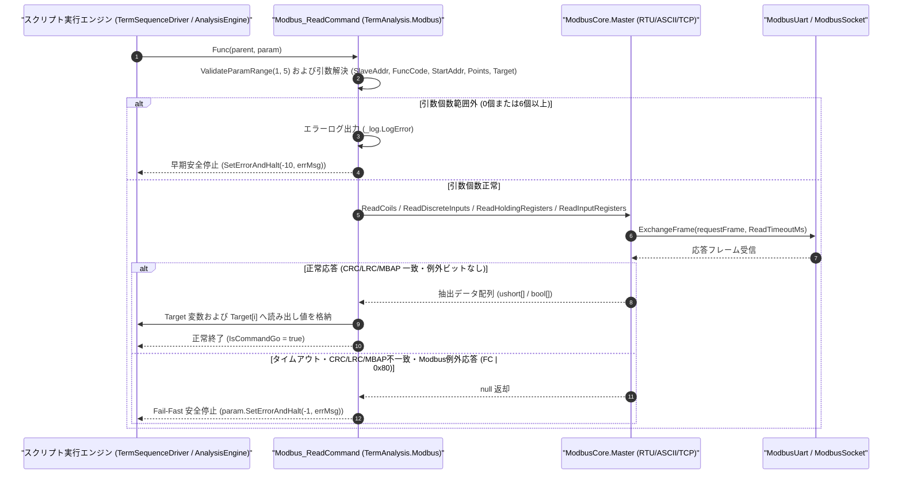

# コマンドリファレンス：Modbus_Read

## 概要

**Modbus_Read** は、指定されたスレーブ局番（Slave ID）の Modbus 機器に対して読み出しファンクションコード（FC01: コイル読出、FC02: 入力ステータス読出、FC03: 保持レジスタ読出、FC04: 入力レジスタ読出）の要求フレームを自動生成・送信し、応答フレームのエラーチェック（CRC-16 / LRC / MBAP ヘッダ検証）を行った上で、読み出したデータ値を指定ターゲット変数（または配列）へ格納するコマンドです。

> 💡 **補足** : `Modbus_Mode` の設定（`RTU` / `ASCII` / `TCP`）に応じて、CRC-16 計算、`:` 開始＋LRC＋CRLF 変換、または 7 バイト MBAP ヘッダ付与をすべて内部で自動処理します。

---

## 💡 書式・パラメータ仕様

### コマンド構文

```csv
; 1. 標準 5 引数構文
,SEQUENCE, [ステップキー], Modbus_Read, "<SlaveAddr>", "<FuncCode>", "<StartAddr>", "<Points>", "<Target>"

; 2. 局番省略 4 引数構文（既定 SlaveId を使用）
,SEQUENCE, [ステップキー], Modbus_Read, "<FuncCode>", "<StartAddr>", "<Points>", "<Target>"
```

※ 上記のほか、既定条件を用いる 1〜3 引数構文（1 引数: `<Target>`、2〜3 引数: `<StartAddr>, [Points], [Target]`）にも対応しています。

### パラメータ（引数）一覧

| 引数位置 | パラメータ名 | 必須/任意 | 型・制約 | 説明 |
| :---: | :--- | :---: | :--- | :--- |
| 第1引数 | `SlaveAddr` | **必須** （5引数時） | 10進整数または `0x` 付き16進表記（`0`〜`255`、TCP時はUnit ID） | 通信対象のスレーブアドレス（局番）を指定します。 |
| 第2引数 | `FuncCode` | **必須** （4〜5引数時） | `"01"` / `"02"` / `"03"` / `"04"`（または `"COIL"`, `"DISCRETE"`, `"HOLDING"`, `"INPUT"` 等） | 読み出し用 Modbus ファンクションコードを指定します（`01`: コイル、`02`: 離散入力、`03`: 保持レジスタ、`04`: 入力レジスタ。コイル／離散入力は `0` または `1` の数値として格納されます）。 |
| 第3引数 | `StartAddr` | **必須** | 10進整数または `0x` 付き16進表記（例: `"0"`, `"100"`, `"0x0010"`） | 読み出し開始アドレス（0 オリジン相対アドレス）を指定します。<br>※ **`"0010"` のように `0x` 接頭辞がない数字列は 10 進数の `10` として解釈されます。16 進アドレスを指定する場合は必ず `"0x0010"` のように `0x` 接頭辞を付与してください。** |
| 第4引数 | `Points` | **必須** | 整数（`1`〜`125` ワード / ビット時は `1`〜`2000`） | 読み出す点数（ワード数またはビット数）を指定します。 |
| 第5引数 | `Target` | 任意（格納時必須） | PARAM 変数キー名（`$` / `@` / `#` なし） | 読み出したデータの格納先変数名（例: `"TEMP_PV"`）を指定します。複数点読み出し時はカンマ区切り文字列（例: `"120,340,560,780"`）が一括格納されると同時に、共有バッファ・変数辞書へインデックス付き要素（`Target[0]`, `Target[1]`, ...）も自動登録されます。 |

---

## 🔄 特殊置換規約・分岐規約の適用

本コマンドの引数における特殊記法および解釈ルールです。
* **動的置換（`$`）** : 引数内で `$PARAMキー$` のように記述すると、実行時に変数プール（PARAM）の値へ動的置換されます。（適用可能な引数: 入力値となる引数。格納先 `Target` には `$` を付けず変数名そのものを指定します）
* **ジャンプ先指定（`#`）** : 本コマンドはジャンプ制御を行わないため適用されません。（適用可能な引数: 非適用）
* **共通コマンド指定（`@`）** : 本コマンドは外部マクロを呼び出さないため、共通コマンド呼び出し記法は適用されません。（適用可能な引数: 非適用）
* **カンマのエスケープ** : 通信条件文字列（例: `"9600,E,7,1"`）や複数データのカンマ区切り値を単一引数として渡す場合は、必ず `"..."` と二重引用符で囲んで記述します。
* **エイリアス（別名）** : `Analysis_ModBus_Read`

---

## 💡 動作例（正しい構文での記述例）

### スクリプト記述例

※COMMAND ブロック配下の子要素行（PARAM, SEQUENCE）は必ず行頭カンマから開始し、スペースインデントや行末コメント（`;`）は記述しないでください。

```csv
COMMAND, "SAMPLE_MODBUS_READ", ""
,PARAM, "SLAVE_ID", Text, "スレーブ局番", "1"
,PARAM, "TEMP_PV", Work, "温度現在値", "0"
,PARAM, "SENSOR_VAL", Work, "入力レジスタ4ワードテーブル", ""
,PARAM, "CH2_VAL", Work, "第2チャネル抽出値", ""
,SEQUENCE, 010, Modbus_Mode, "RTU", "19200,E,8,1", "NONE"
,SEQUENCE, 020, Modbus_Open
; 1. スレーブ1の保持レジスタ(FC03) アドレス0x0000から1ワード読み出して TEMP_PV へ格納
,SEQUENCE, 030, Modbus_Read, "$SLAVE_ID$", "03", "0x0000", "1", "TEMP_PV"
; 2. 4列×1行のテーブル領域を初期化後、入力レジスタ(FC04) アドレス0x0010から4ワード読み出し、2番目の要素を取得
,SEQUENCE, 040, Array_Init, "SENSOR_VAL", "4", "1", ","
,SEQUENCE, 050, Modbus_Read, "$SLAVE_ID$", "04", "0x0010", "4", "SENSOR_VAL"
,SEQUENCE, 060, Array_Get, "SENSOR_VAL", "1", "0", ",", "CH2_VAL"
,SEQUENCE, 070, Modbus_Close
,SEQUENCE, 080, Exit
```

### 実行時の挙動・変数変化

* **実行前の状態** : Term 通信エンジンが初期化され、必要な通信パラメータおよび変数プール（`PARAM`）が準備されている状態。
* **実行後の状態** : 1 回目の `Modbus_Read` では、RTU フレーム `[01][03][00][00][00][01][84][0A]` が送信され、応答フレームの CRC-16 検証後にデータ値が変数 `TEMP_PV` に格納されます。 2 回目の `Modbus_Read` ではアドレス `0x0010`（10 進 `16`）からの 4 ワード分がカンマ区切り文字列として `SENSOR_VAL` に格納され（共有バッファ・変数辞書には `SENSOR_VAL[0]`〜`SENSOR_VAL[3]` も自動登録）、続く `Array_Get` により 2 ワード目（列インデックス `1`、行インデックス `0`）の値が `CH2_VAL` に抽出されます。

---

## 🔄 動作フロー（シーケンス図）



---

## 🚫 エラーハンドリング・安全設計（仕様制限）

1. **CRC-16 / LRC / MBAP 検証および異常時の汚染防止（Fail-Fast 安全停止）** :
   - 応答タイムアウト、チェックサム不一致、またはスレーブからの Modbus 例外応答（`FunctionCode | 0x80`）によりマスターが `null` を返した場合は、破損データやエラー文字列を格納先変数へ一切書き込まず（既存の値を保持したまま）、直ちに `param.SetErrorAndHalt(-1, ...)` を実行してシーケンスを Fail-Fast 安全停止します（※共通基盤の `OnError` は `SetError` コマンド専用の論理エラートラップであるため、通信異常時の自動リトライ用途には使用できません）。また引数個数範囲外時はエラーコード `-10`、予期せぬ例外発生時は `_log.LogCritical` を記録の上エラーコード `-1` で停止します。
2. **16 進アドレス指定時の `0x` 接頭辞ルール** :
   - アドレス解析（`TryParseUInt16Flexible`）では `0x` 接頭辞がない数字のみの文字列（例: `"0010"`）は 10 進数（`10`）として解釈されます。仕様書記載の 16 進アドレスを指定する際は必ず `"0x0010"` のように `0x` を付けて記述してください。

---

## 🧪 ユニットテスト仕様

本コマンドクラス（`Modbus_ReadCommand.cs`）に実装されている `RunUnitTest()` メソッドが検証するユニットテストの仕様です。

### テスト実行前提条件

* **実行トリガー** : `RunUnitTest()` メソッドの呼び出し
* **有効化条件** : システム全体の最小ログレベル（`ErrorLogger.MinimumLevel`）が `LogLevel.Test` であること（それ以外の場合は無効化ガードにより早期リターン）
* **検証結果出力** : `_log.LogTest` によるログ出力。検証失敗時は `_log.LogError`、予期せぬ例外発生時は `_log.LogCritical` で記録し、`finally` ブロックで `UartTransportCore.Shared.IsSimulationMode` を開始前の状態へ復元します。

### テストケース一覧

| No | テストカテゴリ | テスト条件（入力値） | 期待される結果（出力値） | 検証の目的 / 観点 |
| :---: | :--- | :--- | :--- | :--- |
| **1** | 正常系 | `IsSimulationMode = true`・`RTU` モード環境下で擬似レジスタ `200`=`1234`、`201`=`5678` を事前設定し、引数 `"1"`, `"03"`, `"200"`, `"2"`, `"MB_DATA"` を指定して実行 | `!param.HasError` かつ格納先 `SBuf["MB_DATA"]` が `"1234,5678"` と一致する | 保持レジスタ連続読出（FC03・2 ワード）の応答解析およびカンマ区切り格納の検証 |
| **2** | 異常系 | 必須引数を省略（引数 0 個）して `Func(null, invalidParam)` を実行（`ValidateParamRange(1, 5)` 違反） | `invalidParam.HasError == true` かつ `!invalidParam.IsCommandGo` で破損データを格納せず安全に実行拒否・停止する | 必須引数欠落時の境界ガード検証 |
