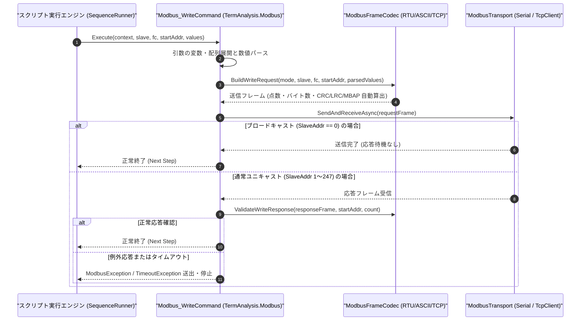

# コマンドリファレンス：Modbus_Write

## 概要

**Modbus_Write** は、指定されたスレーブ局番（Slave ID）の Modbus 機器に対して書き込みファンクションコード（FC05: 単一コイル書込、FC06: 単一保持レジスタ書込、FC15/`0F`: 複数コイル書込、FC16/`10`: 複数保持レジスタ書込）の要求フレームを自動生成・送信し、スレーブからの正常エコー応答（または書き込み点数応答）を検証するコマンドです。

> 💡 **補足**: 書き込みデータ（第 4 引数 `Values`）にカンマ区切りで複数値を指定した場合、FC16（`10h`）のバイト数・点数フィールドおよび CRC-16 / LRC / MBAP ヘッダをすべて自動計算してフレームを構築します。

---

## 💡 書式・パラメータ仕様

### コマンド構文

```csv
,SEQUENCE, [ステップキー], Modbus_Write, "<SlaveAddr>", "<FuncCode>", "<StartAddr>", "<Values>"
```

### パラメータ（引数）一覧

| 引数位置 | パラメータ名 | 必須/任意 | 型・制約 | 説明 |
| :---: | :--- | :---: | :--- | :--- |
| 第1引数 | `SlaveAddr` | **必須** | 整数または16進表記（`0`〜`247`、`0`はブロードキャスト） | 通信対象のスレーブアドレス（局番）を指定します。 |
| 第2引数 | `FuncCode` | **必須** | `"05"` / `"06"` / `"0F"`(`"15"`) / `"10"`(`"16"`) | 書き込み用 Modbus ファンクションコードを指定します（`06`: 単一レジスタ書込、`10`: 複数レジスタ書込等）。 |
| 第3引数 | `StartAddr` | **必須** | 整数または4桁16進（例: `"0000"`, `"200"`） | 書き込み開始レジスタアドレス（0オリジン相対アドレス）を指定します。 |
| 第4引数 | `Values` | **必須** | 数値・16進文字列（複数時はカンマ区切り `"100,200"`）または配列名 `#ARR` | 書き込むデータ値を指定します。複数ワードをカンマ区切りで指定する場合はダブルクォーテーション `""` で囲みます。 |

---

## 🔄 特殊置換規約・分岐規約の適用

本コマンドの引数における特殊記法および解釈ルールです。
* **動的置換（`$`）**: 引数内で `$PARAMキー$` のように記述すると、実行時に変数プール（PARAM）の値へ動的置換されます。（適用可能な引数: 全引数対応）
* **ジャンプ先指定（`#`）**: 本コマンドはジャンプ制御を行わないため適用されません。（適用可能な引数: 非適用）
* **共通コマンド指定（`@`）**: 本コマンドは外部マクロを呼び出さないため、共通コマンド呼び出し記法は適用されません。（適用可能な引数: 非適用）
* **カンマのエスケープ**: 通信条件文字列（例: `"9600,E,7,1"`）や複数データのカンマ区切り値を単一引数として渡す場合は、必ず `"..."` と二重引用符で囲んで記述します。
* **エイリアス（別名）**: `Analysis_ModBus_Write`

---

## 💡 動作例（正しい構文での記述例）

### スクリプト記述例

※COMMAND ブロック配下の子要素行（PARAM, SEQUENCE）は必ず行頭カンマから開始し、スペースインデントや行末コメント（`;`）は記述しないでください。

```csv
COMMAND, "SAMPLE_MODBUS_WRITE", ""
,PARAM, "TARGET_RPM", Text, "TARGET_RPM", "1500"
,SEQUENCE, 010, Modbus_Mode, "RTU", "19200,E,8,1", "NONE"
,SEQUENCE, 020, Modbus_Open
; 1. 単一保持レジスタ書込 (FC06): アドレス0001hへ $TARGET_RPM (1500) を書き込む
,SEQUENCE, 030, Modbus_Write, "1", "06", "0001", "$TARGET_RPM$"
; 2. 複数保持レジスタ書込 (FC16 / 10h): アドレス0010hから3ワード連続書き込み
,SEQUENCE, 040, Modbus_Write, "1", "10", "0010", "100,200,300"
,SEQUENCE, 050, Modbus_Close
,SEQUENCE, 060, Exit
```

### 実行時の挙動・変数変化

* **実行前の状態**: Term 通信エンジンが初期化され、必要な通信パラメータおよび変数プール（`PARAM`）が準備されている状態。
* **実行後の状態**: 1 回目の `Modbus_Write` では FC06 フレームが送信され、スレーブからの同一フレームエコーバック応答の CRC-16 が検証されます。 2 回目の `Modbus_Write` では FC16（`0x10`）フレームとして点数 `3`、バイト数 `6` が自動計算されて送信され、応答の書き込み完了点数（`3` ワード）が照合されます。

---

## 🔄 動作フロー（シーケンス図）



---

## 🚫 エラーハンドリング・安全設計（仕様制限）

1. **ファンクションコードとデータ点数の整合性検証**:
   - 単一書き込み（FC05 / FC06）に対して 2 個以上の値が指定された場合、送信前に `ArgumentException` を送出してプロトコル違反を防止します。
2. **ブロードキャスト（局番 `0`）時の応答待機スキップ**:
   - スレーブアドレスに `"0"`（RTU/ASCII ブロードキャスト）が指定された場合は、スレーブからの応答が返らない仕様であるため、送信完了後に応答待機を行わず規定ディレイのみで次ステップへ進みます。

---

## 🧪 ユニットテスト仕様

本コマンドクラス（`Modbus_WriteCommand.cs`）に実装されている `RunUnitTest()` メソッドが検証するユニットテストの仕様です。

### テスト実行前提条件

* **実行トリガー**: `RunUnitTest()` メソッドの呼び出し
* **有効化条件**: システム全体の最小ログレベル（`ErrorLogger.MinimumLevel`）が `LogLevel.Test` であること（それ以外の場合は無効化ガードにより早期リターン）
* **検証結果出力**: `_log.LogTest` によるログ出力。検証失敗時は `_log.LogError`、予期せぬ例外発生時は `_log.LogCritical` で記録し、`finally` ブロックで `UartTransportCore.Shared.IsSimulationMode` を開始前の状態へ復元します。

### テストケース一覧

| No | テストカテゴリ | テスト条件（入力値） | 期待される結果（出力値） | 検証の目的 / 観点 |
| :---: | :--- | :--- | :--- | :--- |
| **1** | 正常系 | `IsSimulationMode = true`・`RTU` モード環境下で引数 `"1"`, `"16"`, `"300"`, `"4321,8765"` を指定して実行 | `!param.HasError` かつ擬似レジスタ `GetSimulatedRegister(300) == 4321`、`GetSimulatedRegister(301) == 8765` となる | 複数保持レジスタ一括書込（FC16・2 ワード）のフレーム送出および値反映の検証 |
| **2** | 異常系 | 引数範囲外（`ValidateParamRange(1, 4)` 違反）、有効な数値トークンなしの空データ（`writeValues.Count == 0`）、または書込応答失敗（`!ok`） | `SetErrorAndHalt(-1, ...)`（または引数検証エラー）により安全に停止する | 空書込防止・引数境界チェックおよびスレーブ書込失敗時のフェイルセーフ検証 |
