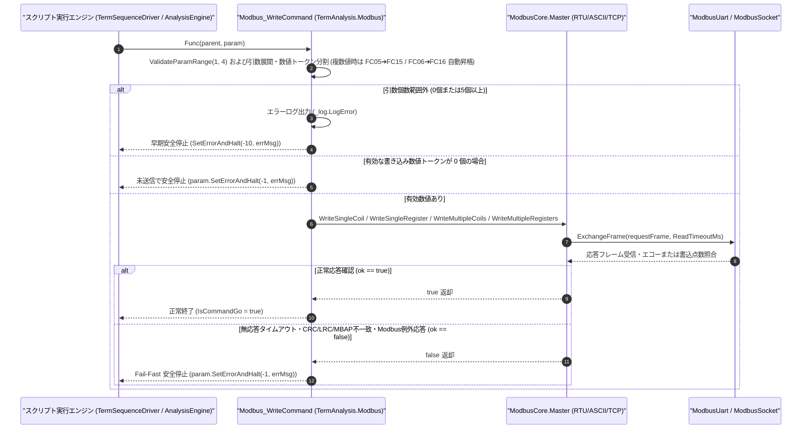

# コマンドリファレンス：Modbus_Write

## 概要

**Modbus_Write** は、指定されたスレーブ局番（Slave ID）の Modbus 機器に対して書き込みファンクションコード（FC05: 単一コイル書込、FC06: 単一保持レジスタ書込、FC15 / `0x0F`: 複数コイル書込、FC16 / `0x10`: 複数保持レジスタ書込）の要求フレームを自動生成・送信し、スレーブからの正常エコー応答（または書き込み点数応答）を検証するコマンドです。

> 💡 **補足** : 書き込みデータ（`Values`）にカンマ・セミコロン・空白区切りで 2 点以上の値を指定した場合、単一書込（FC05 / FC06）を指定していても自動的に複数書込（FC15 / FC16）へ昇格し、点数・バイト数フィールドおよび CRC-16 / LRC / MBAP ヘッダをすべて自動計算してフレームを構築します。

---

## 💡 書式・パラメータ仕様

### コマンド構文

```csv
; 1. 標準 4 引数構文
,SEQUENCE, [ステップキー], Modbus_Write, "<SlaveAddr>", "<FuncCode>", "<StartAddr>", "<Values>"

; 2. 局番省略 2〜3 引数構文（既定 SlaveId を使用）
,SEQUENCE, [ステップキー], Modbus_Write, "<StartAddr>", "<Values>", "[Mode: Single/Multiple]"
```

※ 既定条件を用いる 1 引数構文（`<Values>` のみ）にも対応しています。

### パラメータ（引数）一覧

| 引数位置 | パラメータ名 | 必須/任意 | 型・制約 | 説明 |
| :---: | :--- | :---: | :--- | :--- |
| 第1引数 | `SlaveAddr` | **必須** （4引数時） | 10進整数または `0x` 付き16進表記（`1`〜`255`、TCP時はUnit ID） | 通信対象のスレーブアドレス（局番）を指定します。※局番 `"0"` による無応答ブロードキャスト通過は未実装であり、すべての局番で応答フレーム検証を行います。 |
| 第2引数 | `FuncCode` | **必須** （4引数時） | `"05"` / `"06"` / `"15"`（`"FC15"`, `"0x0F"`） / `"16"`（`"FC16"`, `"0x10"`） | 書き込み用 Modbus ファンクションコードを指定します。<br>・単一コイル書込：`"05"` / `"5"` / `"FC05"` / `"SINGLECOIL"`<br>・単一保持レジスタ書込：`"06"` / `"6"` / `"FC06"` / `"SINGLE"`<br>・複数コイル書込：`"15"` / `"FC15"` / `"FC0F"` / `"0x0F"` / `"MULTIPLECOILS"`<br>・複数保持レジスタ書込：`"16"` / `"FC16"` / `"FC10"` / `"0x10"` / `"MULTIPLE"`<br>※ **注意** : `0x` や `FC` なしの `"0F"` や `"10"`（1 ワード書込時）は FC06 へフォールバックされるため、複数書込には必ず `"15"` / `"16"` または `"FC15"` / `"FC16"` / `"0x0F"` / `"0x10"` を指定してください。 |
| 第3引数 | `StartAddr` | **必須** | 10進整数または `0x` 付き16進表記（例: `"0"`, `"200"`, `"0x0010"`） | 書き込み開始アドレス（0 オリジン相対アドレス）を指定します。<br>※ **`"0010"` のように `0x` 接頭辞がない数字列は 10 進数の `10` と解釈されるため、16 進指定時は必ず `"0x0010"` のように `0x` を付与してください。** |
| 第4引数 | `Values` | **必須** | 数値・`0x` 付き16進文字列（複数時はカンマ／セミコロン／空白区切り `"100,200"`） | 書き込むデータ値を指定します。複数ワードをカンマ区切りで指定する場合は必ずダブルクォーテーション `""` で囲みます（`Array_Init` / `Array_Set` 等で構築したカンマ区切り 1 行テーブル変数を `"$変数名$"` で展開して渡すことも可能です）。 |

---

## 🔄 特殊置換規約・分岐規約の適用

本コマンドの引数における特殊記法および解釈ルールです。
* **動的置換（`$`）** : 引数内で `$PARAMキー$` のように記述すると、実行時に変数プール（PARAM）の値へ動的置換されます。（適用可能な引数: 全引数対応）
* **ジャンプ先指定（`#`）** : 本コマンドはジャンプ制御を行わないため適用されません。（適用可能な引数: 非適用）
* **共通コマンド指定（`@`）** : 本コマンドは外部マクロを呼び出さないため、共通コマンド呼び出し記法は適用されません。（適用可能な引数: 非適用）
* **カンマのエスケープ** : 通信条件文字列（例: `"9600,E,7,1"`）や複数データのカンマ区切り値を単一引数として渡す場合は、必ず `"..."` と二重引用符で囲んで記述します。
* **エイリアス（別名）** : `Analysis_ModBus_Write`

---

## 💡 動作例（正しい構文での記述例）

### スクリプト記述例

※COMMAND ブロック配下の子要素行（PARAM, SEQUENCE）は必ず行頭カンマから開始し、スペースインデントや行末コメント（`;`）は記述しないでください。

```csv
COMMAND, "SAMPLE_MODBUS_WRITE", ""
,PARAM, "TARGET_RPM", Text, "目標回転数", "1500"
,SEQUENCE, 010, Modbus_Mode, "RTU", "19200,E,8,1", "NONE"
,SEQUENCE, 020, Modbus_Open
; 1. 単一保持レジスタ書込 (FC06): アドレス0x0001へ $TARGET_RPM$ (1500) を書き込む
,SEQUENCE, 030, Modbus_Write, "1", "06", "0x0001", "$TARGET_RPM$"
; 2. 複数保持レジスタ書込 (FC16 / 0x10): アドレス0x0010（10進16）から3ワード連続書き込み
,SEQUENCE, 040, Modbus_Write, "1", "16", "0x0010", "100,200,300"
,SEQUENCE, 050, Modbus_Close
,SEQUENCE, 060, Exit
```

### 実行時の挙動・変数変化

* **実行前の状態** : Term 通信エンジンが初期化され、必要な通信パラメータおよび変数プール（`PARAM`）が準備されている状態。
* **実行後の状態** : 1 回目の `Modbus_Write` では FC06 フレームが送信され、スレーブからの同一フレームエコーバック応答の CRC-16 が検証されます。 2 回目の `Modbus_Write` では FC16（`0x10`）フレームとして開始アドレス `0x0010`、点数 `3`、バイト数 `6` が自動計算されて送信され、応答の書き込み完了点数（`3` ワード）が照合されます。

---

## 🔄 動作フロー（シーケンス図）



---

## 🚫 エラーハンドリング・安全設計（仕様制限）

1. **複数データ指定時のファンクションコード自動昇格** :
   - 単一書き込み（FC05 または FC06）を指定した状態で `Values` に 2 点以上の値を渡した場合、エラーとせず自動的に対応する複数書き込み（FC15 または FC16）へ昇格して一括送信します。逆に有効な数値トークンが 0 個（空文字列等）の場合は送信を行わず `SetErrorAndHalt(-1, ...)` で安全に停止します。
2. **応答確認必須（ブロードキャスト無応答通過は非対応）** :
   - すべての書き込み要求に対してスレーブからの正常応答フレーム受信とチェックサム検証を行います。スレーブ局番に `"0"` を指定した場合でも無応答通過（ブロードキャストスキップ）は行われず、応答がない場合はタイムアウトエラーとして安全停止します。

---

## 🧪 ユニットテスト仕様

本コマンドクラス（`Modbus_WriteCommand.cs`）に実装されている `RunUnitTest()` メソッドが検証するユニットテストの仕様です。

### テスト実行前提条件

* **実行トリガー** : `RunUnitTest()` メソッドの呼び出し
* **有効化条件** : システム全体の最小ログレベル（`ErrorLogger.MinimumLevel`）が `LogLevel.Test` であること（それ以外の場合は無効化ガードにより早期リターン）
* **検証結果出力** : `_log.LogTest` によるログ出力。検証失敗時は `_log.LogError`、予期せぬ例外発生時は `_log.LogCritical` で記録し、`finally` ブロックで `UartTransportCore.Shared.IsSimulationMode` を開始前の状態へ復元します。

### テストケース一覧

| No | テストカテゴリ | テスト条件（入力値） | 期待される結果（出力値） | 検証の目的 / 観点 |
| :---: | :--- | :--- | :--- | :--- |
| **1** | 正常系 | `IsSimulationMode = true`・`RTU` モード環境下で引数 `"1"`, `"16"`, `"300"`, `"4321,8765"` を指定して実行 | `!param.HasError` かつ擬似レジスタ `GetSimulatedRegister(300) == 4321`、`GetSimulatedRegister(301) == 8765` となる | 複数保持レジスタ一括書込（FC16・2 ワード）のフレーム送出および値反映の検証 |
| **2** | 異常系 | 必須引数を省略（引数 0 個）して `Func(null, invalidParam)` を実行（`ValidateParamRange(1, 4)` 違反） | `invalidParam.HasError == true` かつ `!invalidParam.IsCommandGo` で未送信のまま安全に実行拒否・停止する | 必須引数欠落時の境界ガード検証 |
