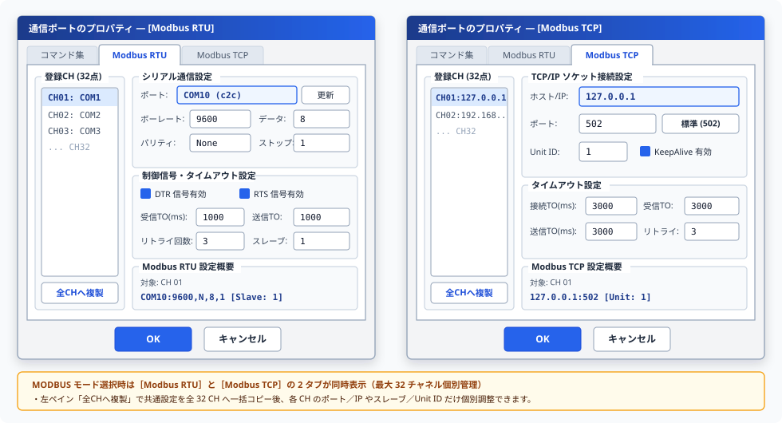

# Modbus（Modbus RTU / ASCII / TCP）アドイン取扱説明書

👉 [← TermAddIn_Modbus 製品トップに戻る](../README.md)  
👉 [← プロパティ設定画面取扱説明書（共通）](../プロパティ設定画面取扱説明書.Md) ／ [← TermEmulator 操作説明書（共通）](https://github.com/Monaca-App/TermEmulator/blob/main/Manual/TermEmulator操作説明書.Md) ／ [← マクロスクリプト取扱説明書（共通）](../マクロスクリプト取扱説明書.Md)

---

本書は、**TermAddIn_Modbus**（`TermAnalysis.Modbus.dll`：Modbus RTU / ASCII / TCP 通信エクステンション）の **取扱説明書 兼 機能解説書** です。Modbus 規格の基礎仕組み、プロパティ設定画面の **「Modbus RTU」／「Modbus TCP」タブ**、**TermEmulator の `[Modbus]` 仮想スレーブタブ**、および全 5 コマンドのリファレンスを 1 冊にまとめています。

* **必須拡張ライセンス**: **`TermAddIn_Modbus.License`** （組み込み先: `TermAnalysis.Modbus.dll`、`TermEmulator` と相互共用）


### 関連する公式規格・仕様書（外部リンク）
* [Modbus Organization 公式サイト（Modbus 公式規格・技術資料）](https://www.modbus.org/) — 「Resources / Technical Resources」より以下の一次公式仕様書（PDF）を無償参照できます。
  * *MODBUS Application Protocol Specification*（ファンクションコード・データモデル・例外コード仕様）
  * *MODBUS over Serial Line Specification and Implementation Guide*（RTU / ASCII・CRC-16 / LRC 仕様）
  * *MODBUS Messaging on TCP/IP Implementation Guide*（Modbus TCP・MBAP ヘッダ・ポート `502` 仕様）
---

## 目次

- [1. 機能概要と基礎知識（はじめての方へ）](#1-機能概要と基礎知識はじめての方へ)
- [2. プロパティ設定画面：「Modbus RTU」／「Modbus TCP」タブの詳細](#2-プロパティ設定画面modbus-rtumodbus-tcpタブの詳細)
- [3. TermEmulator 仮想スレーブ設定：「[Modbus]」タブの詳細](#3-termemulator-仮想スレーブ設定modbusタブの詳細)
- [4. マクロコマンド一覧（全 5 コマンド）](#4-マクロコマンド一覧全-5-コマンド)

---

## 1. 機能概要と基礎知識（はじめての方へ）

### 対応する機能の概要
**Modbus（モドバス）** アドインは、世界中の工場・設備機器で広く使われている標準通信規格 **Modbus RTU / Modbus ASCII / Modbus TCP** の 3 方式すべてに対応し、温調器・電力計・インバータ・センサー・各社 PLC のコイル（ON/OFF）およびレジスタ（数値）を自動読み書きする通信機能です。

### 機能の実現方法
* **フレーム組み立て・誤り検出の完全自動化**: バイナリ電文の組み立て、RTU の **CRC-16** 計算、ASCII の **LRC** 計算、TCP の **MBAP ヘッダ（Transaction ID 管理）** をすべてアドイン内部で自動処理します。利用者は「局番・ファンクションコード・開始アドレス・点数」を指定するだけです。
* **最大 32 チャネル設定と自動昇格書込**: プロパティ画面で最大 32 系統（`CH01`〜`CH32`）の機器設定を保持でき、`Modbus_Write` で複数値を渡した場合は単一書込（`FC05`/`FC06`）から複数書込（`FC15`/`FC16`）へ自動切替します。
* **実機不要の例外応答テスト**: `TermEmulator` の `[Modbus]` タブにより、通常読み書きだけでなく異常応答（`Exception 01`〜`06`）の模擬テストまで机上で完結します。

### このアドインを選択することの利点
* **1 つのアドインでシリアルも LAN も対応**: 現場に RS-485（RTU/ASCII）の機器と LAN（TCP）の機器が混在していても、追加製品なしで同じコマンド（`Modbus_Read` / `Modbus_Write`）のまま制御できます。
* **高価な専用 SCADA や OPC サーバーが不要**: 外部ドライバやランタイムの購入・設定なしで、使い慣れた Excel シートから直接データを収集・グラフ化・帳票出力できます。
* **メーカー横断の資産再利用**: 温調器や電力計のメーカーが変わっても、アドレス表の番号を書き換えるだけで同じマクロ手順をそのまま使い回せます。

### 3 つの通信方式の違い（どれを選ぶべきか）
Modbus には配線の種類によって以下の 3 種類があります。**繋ぐケーブルの種類** で選んでください。

| 通信方式 | 使うケーブル | 特徴と選び方 |
| :--- | :--- | :--- |
| **Modbus RTU** | シリアル（RS-485 / RS-232C） | 工場で最も一般的。データを短いバイナリ（数値の塊）で送るため高速です。1 本の線に複数台（最大 247 台）を数珠つなぎにできます。 |
| **Modbus ASCII** | シリアル（RS-485 / RS-232C） | RTU と同じ配線ですが、データを人間が読める文字で送ります。機器側が ASCII 指定の場合のみ選びます。 |
| **Modbus TCP** | LAN ケーブル（Ethernet） | 最近の機器で主流。IP アドレスと標準ポート **`502`** を使って高速に通信します。 |

### 設定の妥当性を判断するための主要用語と確認項目
Modbus のマニュアルには独特の用語が出てきますが、仕組みはとてもシンプルです。

* **スレーブアドレス / 局番（Unit ID：`1`〜`247`）**: 同じ線に複数台の機器を繋いだとき、通信対象となる機器を指定するための **機器ごとの識別番号** です。相手機器の本体スイッチや設定画面に書いてある番号と合わせます（1 台だけのときは `1` が一般的です）。
* **レジスタとコイル（データの種類）**:
  * **コイル（Coil）**: スイッチの **ON / OFF（1 ビット）** を表す箱です。
  * **レジスタ（Register）**: 温度や電圧などの **数値（16 ビット整数）** を入れる箱です。
* **ファンクションコード（FC）**: 「どの種類の箱を、読むのか書くのか」を指定する **作業番号** です。
  * よく使うのは **`FC03`（保持レジスタを読む）**、**`FC04`（入力レジスタを読む）**、**`FC06` / `FC16`（レジスタに書く）** の 3 つです。相手機器の「Modbus アドレス一覧表」に書いてある番号をそのまま指定します。
* **CRC / LRC（誤りチェック）**: 通信途中でノイズが乗っていないか確認する計算値ですが、**本アドインが自動計算する** ため利用者が計算する必要はありません。

### 通信の仕組み解説（フレーム構造と代表的なトラブル事例・対処法）
Modbus は「パソコン（マスタ）が質問し、機器（スレーブ）が答える」1 問 1 答方式です。伝送方式ごとに外側の包み方だけが異なり、中身（ファンクションコード＋アドレス＋データ）は共通です。

```text
[Modbus RTU]   [局番 1B] + [FC 1B] + [アドレス/点数/データ] + [CRC-16 2B]
[Modbus ASCII] ":" + [局番・FC・データ (ASCII文字)] + [LRC 2文字] + [CR LF]
[Modbus TCP]   [MBAPヘッダ 6B] + [UnitID 1B] + [FC 1B] + [アドレス/点数/データ]
```

* **事例①（最重要）：アドレス指定が 1 番地ずれる事象** ➔ 機器のマニュアルで「保持レジスタ `40001`」と書かれている場合、実際の通信電文では先頭の `4`（保持レジスタの意味）を除き、さらに `1` を引いた **`0`**（0 始まり）を指定するのが Modbus の慣習です。取得値が隣接アドレスとずれる場合は開始アドレスを ±1 確認してください。
* **事例②：16 進アドレスをそのまま書いてしまう** ➔ マニュアルに「アドレス `0010H`（16 進）」と書かれている場合は、本アドインの引数に `"0x0010"` のように必ず **`0x`** を付けて指定します（付けないと 10 進数の `10` と解釈されます）。
* **事例③：例外コード（`Exception 01 / 02 / 03`）が返る** ➔ `01` は機器がその FC に非対応、`02` は存在しないアドレス範囲を指定、`03` は許容範囲外の値を書き込もうとしたことを示します。

---

## 2. プロパティ設定画面：「Modbus RTU」／「Modbus TCP」タブの詳細



メイン画面で **`MODBUS`** モードを選択しているときに、 **「Modbus RTU」** と **「Modbus TCP」** の 2 タブが同時に表示されます（[`Modbus_Open`](./Modbus_Open.Md) 対応）。

* **最大 32 チャネル管理（`CH01`〜`CH32`）**: 上部のチャネル選択から最大 32 系統の機器設定を個別に保持でき、 **`[ 全CHへ複製 ]`** ボタンを使うと現在のチャネル設定を全 32 チャネルへ一括コピーしてからアドレスだけ微調整できます。

| タブ名 | 主な設定項目とポイント |
| :--- | :--- |
| **`Modbus RTU`** | ・ **COM ポート** （物理 COM または `c2c` / `TermEmulator` 仮想 COM）<br>・ **シリアル条件** （ボーレート、データ長、パリティ、ストップビット、フロー制御、`DTR` / `RTS` 信号線有効）<br>・ **通信制御** （送受信タイムアウト ms、リトライ回数、スレーブアドレス `1`〜`247`） |
| **`Modbus TCP`** | ・ **接続先ホスト / IP** （ローカルテスト時は `127.0.0.1`）<br>・ **TCP ポート** （標準 `502`、`[ 標準 (502) ]` ボタン付）<br>・ **通信制御** （Unit ID、`KeepAlive 有効`、リトライ回数、接続・送受信タイムアウト ms） |

### 複数チャネル（CH01〜CH32）の効率的な設定手順
1. メイン画面で **`[通信モード(M)] ➔ [MODBUS]`** を選択し、プロパティ画面の **「Modbus TCP」** タブを開きます。
2. `CH01` に共通となるポート番号（`502`）・タイムアウト（`3000` ms）・リトライ回数を設定し、 **`[ 全CHへ複製 ]`** ボタンをクリックします。
3. 続けて `CH02`, `CH03` ... を選び、異なる IP アドレスや Unit ID だけを書き換えて **`[OK]`** で保存します。

---

## 3. TermEmulator 仮想スレーブ設定：`[Modbus]` タブの詳細

* **主な用途**: Modbus TCP サーバー（標準ポート `502`）、Modbus RTU / ASCII シリアルスレーブ（仮想 COM / 物理 COM）の模擬。


| 設定区分 | 設定項目 | 設定値・範囲（既定値） | 詳しい動作と設定のポイント |
| :--- | :--- | :--- | :--- |
| **① フレーミング・局番** | **伝送形式** | `自動判別`（既定） / `Modbus TCP` / `Modbus RTU` / `Modbus ASCII` | `自動判別` を選んでおくと、TCP 接続時は MBAP ヘッダ（Transaction ID 自動引き継ぎ）、シリアル接続時は RTU（CRC-16 自動検証・付与）および ASCII（`:`〜`CRLF`・LRC 自動検証・付与）を自動で処理します。 |
| | **局番 (Unit ID)** | `1`〜`247`（既定 `1`） | 自局のスレーブアドレスを指定します。 |
| | **ブロードキャスト / 全局応答** | `Unit=0 書込受理` / `全 Unit ID 応答` | `Unit=0 書込受理` を ON にするとブロードキャスト書込を受け入れます。`全 Unit ID 応答`（ワイルドカード）を ON にすると、上位からどの局番で問い合わせが来ても応答します。 |
| | **32bit ワード順 / 遅延 / 番地上限** | `AB CD` / `CD AB` ・ 基準遅延(ms) ・ 番地上限（既定 `9999`） | 2 ワード（32bit 整数・Float32）のエンディアン順序、基準応答遅延、および許容アドレス上限（超過時は `Exception 02` を返却）を設定します。 |
| **② 許可 FC** | **対応ファンクションコード** | `FC01` / `FC02` / `FC03` / `FC04` / `FC05` / `FC06` / `FC0F` / `FC10` / `FC17` | コイル読出（`01`）、入力読出（`02`）、保持レジスタ読出（`03`）、入力レジスタ読出（`04`）、単一書込（`05`/`06`）、複数書込（`0F`/`10`）、読書き同時（`17`）を個別に ON / OFF できます。OFF にした FC を受信すると規格どおり `Exception 01 (Illegal Function)` を返します。 |
| **③ 例外応答模擬** | **応答種別 / 発動条件** | `00: 通常応答` / `01`〜`06` 例外<br>常時 / N 回に 1 回 / 確率 `%` | `01`（不正機能）、`02`（不正データアドレス）、`03`（不正データ値）、`04`（スレーブ故障）、`05`（Acknowledge）、`06`（スレーブビジー）の Modbus 例外フレーム（`FC | 0x80`）を意図的に返却して上位アプリの異常処理を確認できます。 |

> [!TIP]
> **はじめての設定例（Modbus TCP サーバー）**:
> 動作モードを **`TCP サーバー仮想機器`** （`127.0.0.1`・ポート `502`）、上部ヘッダ `プロトコル` を **`Modbus`** 、Unit ID を **`1`** にして開始します。仮想メモリ監視画面で `4x` 番地 `0` に `1234` を入力すれば、Modbus クライアントから `4x0000`（FC03）を読み出した瞬間に `1234` が返ります。

---

## 4. マクロコマンド一覧（全 5 コマンド）

* **[Modbus_Open](./Modbus_Open.Md)** / **[Modbus_Close](./Modbus_Close.Md)**
  * **概要**: 伝送モード（`"RTU"` / `"ASCII"` / `"TCP"`）、接続先ポート／IP、ボーレート／TCP ポート、および既定スレーブ局番（`0`〜`255`）を指定して Modbus 通信回線を排他接続オープン（`Modbus_Open`、0〜4 引数）、および切断（`Modbus_Close`）します。
  * **書式**:  
    `,SEQUENCE, [ステップキー], Modbus_Open, "[Mode(RTU/ASCII/TCP)]", "[PortOrIp(任意)]", [BaudOrPort(任意)], [SlaveId(任意: 0〜255)]`  
    `,SEQUENCE, [ステップキー], Modbus_Close`
* **[Modbus_Mode](./Modbus_Mode.Md)**
  * **概要**: Modbus 伝送モード（`"RTU"` / `"ASCII"` / `"TCP"`）および UART 通信条件・フロー制御を設定します（最低 1 引数必須。CRC-16 / LRC / MBAP ヘッダはエンジン側で自動計算・検証）。
  * **書式**: `,SEQUENCE, [ステップキー], Modbus_Mode, "[モード(RTU/ASCII/TCP)]", "[UART条件(任意)]", "[フロー制御(任意)]"`
  * **指定例**: `,SEQUENCE, 10, Modbus_Mode, "RTU", "$BAUD$,$PARITY$,$DATA_BITS$,$STOP_BITS$", "$FLOW_CTRL$"`
* **[Modbus_Read](./Modbus_Read.Md)**
  * **概要**: 指定スレーブからコイル（`"FC01"` / `"1"`）、入力ステータス（`"FC02"` / `"2"`）、保持レジスタ（`"FC03"` / `"3"`）、または入力レジスタ（`"FC04"` / `"4"`）を指定点数分読み出し、格納先パラメータへ格納します（※16 進アドレスは `"0x0010"` のように必ず `0x` 接頭辞を付与してください）。
  * **書式**: `,SEQUENCE, [ステップキー], Modbus_Read, [スレーブ局番], "[ファンクション]", [開始アドレス], [点数], "[格納先キー]"`
  * **指定例**: `,SEQUENCE, 20, Modbus_Read, "$SLAVE_ID$", "FC03", "$START_ADDR$", "$POINTS$", "RESULT_DATA"`
* **[Modbus_Write](./Modbus_Write.Md)**
  * **概要**: 指定スレーブへ単一コイル（`"FC05"` / `"5"`）、単一レジスタ（`"FC06"` / `"6"`）、複数コイル（`"FC15"` / `"15"` / `"0x0F"`）、または複数レジスタ（`"FC16"` / `"16"` / `"0x10"`）を書き込みます（単一書込 FC 指定時にカンマ区切りの複数値を渡した場合は自動的に FC15 / FC16 へ昇格します）。
  * **書式**: `,SEQUENCE, [ステップキー], Modbus_Write, [スレーブ局番], "[ファンクション]", [開始アドレス], "[書込値(カンマ区切り可)]"`
